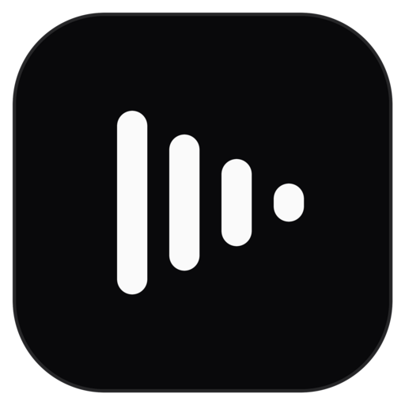

<div align="center">



# Zuno

**Ultra-lightweight, offline-first music player for humans and AI.**

Built for **Linux & Android** with minimal RAM, CPU, and storage footprint — zero cloud lock-in, zero duplicate audio files, and native **Model Context Protocol (MCP)** support.

[](./CHANGELOG.md)
[](https://www.rust-lang.org/)
[](https://react.dev/)
[](https://tailwindcss.com/)
[](./LICENSE)

</div>

---

## Why Zuno?

Most modern cross-platform music players bundle a full Chromium runtime (150–300 MB RAM) or lock playlists inside proprietary databases that break between desktop and phone.

**Zuno** is designed around four strict principles:
1. **Tiny Footprint** — Standalone native Linux Tauri v2 binary (**~9.8 MB**, zero Electron/Chromium, pure-Rust audio + system tray destroy-WebView background playback) and a single-binary CLI/MCP/embedded-UI server (**~4.7 MB**, **~5 MB RSS** idle).
2. **100% Offline & Portable** — Drop songs into `~/zuno/songs/` and sync the folder between Linux and Android via USB or Syncthing — zero external network requests or cloud font loads.
3. **Zero-Copy Self-Healing Playlists** — Playlists are plain-text UTF-8 `.m3u8` pointers (`../songs/...`) with fast 64 KiB BLAKE3 fingerprints (`#EXTZUNO-ID`) that auto-repair if you rename or move files — no symlinks (which break on Android FUSE) and zero duplicated audio bytes.
4. **Human + AI Ready** — Built-in MCP server (`stdio` and Streamable HTTP) and live Unix socket IPC let AI assistants search your library, control playback, and curate offline `.m3u8` playlists directly alongside the native GUI.

---

## Features

- **Minimal Cross-Platform UI** — Strict 60 / 30 / 10 shadcn/ui Dark & Light design with a full-height desktop rail, clickable floating horizontal player bar, compact overlay scrollbars, mobile top navbar with outside Theme Toggle + slide-over menu, and a nested two-tier mobile dock (`Songs`, `Search`, `Recent`, `Playlists`) with compact animated playing bars.
- **Full-Screen Now Playing (Desktop & Mobile)** — Click the desktop bottom dock or tap the mobile mini-player to launch a distraction-free two-zone full-screen player with centered typography, customizable scrubber, split `elapsed | total` timestamps, Previous / Play-Pause / Next tray, and a swipe-up/clickable **Queue & Playlists** sheet.
- **Songs, Playlists Hub & Last Played** — Focused **Songs** library with live **Sort by** (`Name`, `Artist`, `Album`, `Time`, `Size`, `Duration`) in **Ascending / Descending** order, a dedicated **Playlists** hub, a dedicated **Last Played** history view, and auto-flipping **EaseUI Dropdown Menus** (`@easeui/dropdown-menu`) across rows, sort controls, and playback options.
- **Bencho Spring Search Overlay (`Ctrl/Cmd + K`)** — Zero-page morphing circle-to-pill search overlay with instant matching results underneath for both desktop and mobile.
- **10-Band Studio Equalizer (Pure Rust + Web Audio)** — Real-time 10-band ISO DSP (`32 Hz–16 kHz`) with draggable spline curve, 10 precision vertical faders, Preamp, automatic headroom trim + transparent Soft Limiter, Bass/Mid/Treble quick trims, 16 built-in presets across 4 categories, and unlimited saved custom presets — running natively in pure Rust (`zuno-audio`) inside the desktop app with zero allocations per sample.
- **Full Appearance Studio** — Hierarchical live-preview **Customize** studio with 8 dual-mode Dark/Light theme families, interactive HSV 60/30/10 Custom Palette Studio, Custom Font Studio (16 self-hosted variable fonts + OS fonts + `.woff2/.ttf/.otf` uploads), 8 icon packs, 4 View Transitions, 6 surface materials, 5 canvas patterns, 4 active-song styles, and 7 progress scrubber styles.
- **Native Desktop Tray & Pure-Rust Audio Engine** — Decodes MP3, FLAC, OGG, Opus, WAV, M4A, AAC, AIFF, ALAC, and WebM natively via `symphonia` + `rodio` with `lofty` tag scanning and zero-TCP `zuno://` cover loading. Closing the desktop window while playing destroys the WebView to free RAM while music continues seamlessly in the system tray.
- **Built-in Self-Updater & Zero-Copy Data Backup** — Detects new GitHub Releases in the background (100% silent when offline), notifies you with an interactive release dialog, automatically backs up playlists, folders, EQ presets, and appearance settings into `~/zuno/.zuno/backups/` (keeping the last 5 snapshots without duplicating `songs/`), verifies SHA-256, swaps binaries atomically, and restarts into the new version in one click.
- **Built-in CLI, Daemon & MCP Server** — Control Zuno from the UI, terminal, or any MCP-compatible AI client (`Claude`, `Cursor`, `Antigravity`, etc.) sharing one live state over local IPC.

---

## Folder Layout (`~/zuno`)

All user files live in `~/zuno` by default (override anytime with `ZUNO_DIR=/path/to/zuno`):

```text
zuno/
├── songs/                      # Drop audio files or subfolders here
│   ├── ambient/
│   │   └── midnight_chords.wav
│   └── focus/
│       └── warm_pulse.flac
├── playlists/                  # Zero-copy relative .m3u8 playlists (~1 KB each)
│   └── favorites.m3u8
└── .zuno/                      # Auto-generated local cache (safe to delete)
    ├── index.json
    └── state.json
```

Example `zuno/playlists/favorites.m3u8`:

```m3u8
#EXTM3U
#PLAYLIST:Favorites
#EXTINF:182,Artist - Track Title
#EXTZUNO-ID:4d91e77c12a091bc
../songs/focus/warm_pulse.flac
```

If a file is renamed or moved inside `zuno/songs/`, Zuno resolves it via `#EXTZUNO-ID` → `#EXTINF` fallback → filename match and rewrites the `.m3u8` pointer atomically.

---

## Architecture

```text
zuno/
├── crates/
│   ├── zuno-core/      # Pure Rust: scanner, lofty tags, BLAKE3 IDs, .m3u8 self-healer, queue, search, watcher
│   ├── zuno-audio/     # Desktop audio thread (rodio + symphonia + pure-Rust 10-band EQ), ZunoService, Unix IPC
│   └── zuno-mcp/       # Single ~4.7 MB binary: CLI, daemon, HTTP API + embedded UI, stdio & HTTP MCP server
├── src-tauri/          # Standalone ~9.8 MB native Tauri v2 desktop binary (direct IPC + tray + Rust audio + self-updater)
├── public/             # Minimalist B&W SVG/PNG app icons, web manifest & 16 self-hosted variable fonts
├── install.sh          # Zuno-themed single-binary CLI installer for Linux & macOS
├── install.ps1         # Zuno-themed single-binary CLI installer for Windows (PowerShell)
├── scripts/
│   ├── zuno-build.sh   # Storage-lean Cargo build/test/sweep helper (paired with justfile)
│   └── install-linux.sh # Local zero-sudo Linux installer from source builds
└── src/                # React 19 + TypeScript + Vite + Tailwind CSS v4 + shadcn/ui frontend
    ├── pages/          # HomePage, LastPlayedPage, PlaylistsPage, PlaylistPage, EqualizerPage, CustomizePage
    ├── components/     # DesktopSidebar, DesktopPlayerBar, MobileNavbar, MobileDock, NowPlayingPanel, SearchOverlay, UpdateDialog, TrackRow, SortControl
    └── lib/            # zunoApi (Tauri IPC + HTTP), equalizer, appearance, fonts, sortTracks
```

---

## Quick Install (Single Binary — Linux, macOS & Windows)

Install the latest pre-built standalone **Zuno** desktop app + CLI directly from GitHub Releases with zero build tools required. The installer verifies SHA-256 checksums, automatically backs up any existing playlists & settings, and sets up your desktop launcher:

### Linux & macOS
```bash
curl -fsSL https://raw.githubusercontent.com/aswin402/zuno/main/install.sh | bash
```

### Windows (PowerShell)
```powershell
irm https://raw.githubusercontent.com/aswin402/zuno/main/install.ps1 | iex
```

### Android (APK)
Download the latest signed **`zuno-android-arm64.apk`** directly from [GitHub Releases](https://github.com/aswin402/zuno/releases/latest) (Android 7.0+ / API 24+, ARM64). On first launch, allow audio storage access so Zuno automatically scans your phone's `Music`, `Download`, and `zuno/songs` folders with zero-copy playback, 10-band Rust EQ, FFT visualizers, and Online FM radio.

**Installer options:**
- Install a specific release: `... | bash -s -- --version v0.0.15` (Linux/macOS) or `-Version v0.0.15` (Windows)
- Uninstall binaries & launchers (keeps `~/zuno/songs` & playlists): `--uninstall` / `-Uninstall`
- Already installed? Zuno checks GitHub Releases automatically on launch (silently skipped when offline) and lets you **Backup & Install** new versions right inside the app via **Updates & Backup**.

---

## Build & Install from Source (Linux)

### System Libraries (Ubuntu / Debian)
```bash
sudo apt update && sudo apt install -y \
  libasound2-dev libwebkit2gtk-4.1-dev libgtk-3-dev \
  libayatana-appindicator3-dev librsvg2-dev libssl-dev patchelf
```

### Build & Install (Zero Sudo)
Build and install the standalone native **Zuno** desktop app (`~/.local/bin/zuno`), CLI/MCP binary (`~/.local/bin/zuno-mcp`), hicolor icons, and Application Menu shortcut:

```bash
npm install
npm run build
cargo build --release -p zuno -p zuno-mcp
./scripts/install-linux.sh
```

After installation:

```bash
# Launch the standalone native Zuno desktop app (also available in your Application Menu)
zuno

# Control the live desktop app or run MCP diagnostics from the terminal
zuno-mcp doctor
zuno-mcp status
zuno-mcp play --playlist favorites
```

Drop your audio files into `~/zuno/songs/` and close the window while playing to keep music running silently in the system tray at minimal RAM.

---

## Development Quick Start

### Prerequisites
- **Rust** (1.85+ / Edition 2024) + ALSA dev headers on Linux (`libasound2-dev`)
- **Node.js** 20+ (or **Bun**)

### 1. Build & Test the Rust Engine

```bash
cargo test --workspace
cargo build --release -p zuno-mcp
```

### 2. Run the Web UI + Backend Locally

```bash
# Terminal 1 — Start the Rust audio, library & MCP server (pointing at ~/zuno)
./target/release/zuno-mcp mcp --http 127.0.0.1:47620

# Terminal 2 — Start the frontend dev server (hot-reload)
npm install
npm run dev
```

Open **http://127.0.0.1:5173** (or pass `--web-dir ./dist` to `zuno-mcp` to serve the production build directly on **http://127.0.0.1:47620**).

### 3. Connect an AI Agent (MCP)

Run `zuno doctor` or add to your MCP client configuration (Claude Desktop, Cursor, Antigravity, etc.):

```json
{
  "mcpServers": {
    "zuno": {
      "command": "/home/youruser/.local/bin/zuno-mcp",
      "args": ["mcp"],
      "env": {
        "ZUNO_DIR": "/home/youruser/zuno"
      }
    }
  }
}
```

For remote / Android / LAN agents, run Streamable HTTP mode with Bearer auth:

```bash
zuno-mcp mcp --http 127.0.0.1:47620 --token your-secret-token
```

---

## Roadmap

- [x] **v0.0.1** — `zuno-core`, `zuno-audio`, `zuno-mcp` (CLI + daemon + stdio/HTTP MCP), zero-copy self-healing `.m3u8` playlists, responsive Web UI.
- [x] **v0.0.2** — Live 10-band Web Audio Equalizer, Zenko-grade Appearance Studio, Bencho spring Search overlay, dedicated Last Played page, nested Mobile Dock.
- [x] **v0.0.3** — Minimalist black & white logo & app icons, Mobile Navbar + Playlists Hub, unified Full-Screen Now Playing player (desktop & mobile), EaseUI Dropdown Menus, built-in static UI server & zero-sudo Linux installer.
- [x] **v0.0.4** — Standalone native Linux Tauri v2 desktop binary (`~9.8 MB`), pure-Rust 10-band biquad EQ + soft limiter, Destroy-WebView tray background playback, compile-time embedded Web UI in `zuno-mcp`, and audio/RAM/CPU smoothness optimizations.
- [x] **v0.0.5** — Native Linux MPRIS2 D-Bus media banner & system media keys, custom themed frameless desktop titlebar, zero-copy multi-directory music library, pure-Rust equal-power crossfade transitions, full-screen Customize Studio, and Skiper UI component options.
- [x] **v0.0.6** — Large-library performance overhaul: windowed list virtualization (`VirtualTrackList`), async Rust `gdk-pixbuf` thumbnail cache (`~4 KB` covers), zero-rerender `CompactScrollArea`, WebKitGTK compositor optimization, and borderless Now Playing header controls.
- [x] **v0.0.7** — Rounded curved frameless desktop window corners, Skiper 89/94/95 zero-rerender scroll progress indicators, Great UI Blur Scroll Reveal & theme transitions, SmoothUI Kinetic theme toggle, and SmoothUI/Great UI floating desktop navigation themes.
- [x] **v0.0.8** — Hierarchical Customize Studio tree menu separating all 19 visual and audio components into dedicated pages with interactive live previews (`StudioPreviews.tsx`).
- [x] **v0.0.9** — Desktop Now Playing UX fix: borderless up-arrow Queue trigger button replacing the mobile swipe line on desktop, smooth bidirectional drawer slide/fade transitions, and full-height viewport fit below the custom titlebar.
- [x] **v0.0.10** — Sticky floating mobile bottom dock (`MobileDock.tsx`) with transparent backdrop removal and adaptive scroll clearance.
- [x] **v0.0.11** — Bottom-only React Bits `GradualBlur` progressive liquid edge blur behind floating mobile and desktop docks with Customize Studio preview & toggle.
- [x] **v0.0.12** — Real-time bass & frequency-reactive Now Playing Visualizers backed by a lock-free pure-Rust 1024-pt FFT spectrum tap (`Sound Orb`, `Spectrum Wave Bars`, `Harmonic Waves`, `Radial Bass Ring`, `Ambient Bass Halo`), serene paused idle state, responsive fluid layout, quick switcher, and Customize Studio controls.
- [x] **v0.0.13** — Zero-dependency `transitions.dev` UI motion system (`TextSwap`, `IconSwap`, `SlidingTabs`, `MotionSwitch`, `AccordionPanel`, `MotionToast`) with asymmetric open/close polish across modals, tooltips, dropdowns, players, Customize Studio, Equalizer, and page transitions.
- [x] **v0.0.14** — Fixed Linux MPRIS2 `PropertiesChanged` D-Bus signature (`(sa{sv}as)`) and wired instant GUI/tray notification updates so GNOME/KDE media banners accurately reflect Playing/Paused status and live track metadata.
- [x] **v0.0.15** — Automated cross-platform GitHub Releases (Linux, macOS, Windows), Zuno-themed animated CLI installers (`install.sh` + `install.ps1`), and in-app self-updater with release dialog, SHA-256 verification, and automatic zero-copy data backup.
- [x] **v0.0.16** — Fixed audio thread auto-advance starvation under UI/MPRIS status polling (both sequential order and shuffle modes), plus true random shuffle start and repeat-all cycle re-shuffling.
- [x] **v0.0.17** — Desktop Now Playing layout refresh: moved scrubber & split timestamp into the bottom dock above playback controls (with dark/light contrast support), lowered the track title, and expanded all 5 Now Playing visualizers for large responsive desktop canvases.
- [x] **v0.0.18** — Offline FM (hardware signal dial + RTL-SDR/V4L2 receiver pipeline) & Online FM player (127 curated stable stations, custom link pasting with `.pls`/`.m3u` & ICY metadata probing, 45,000+ station live discovery, and unified offline signal / online link bookmarking backed up in `radio.json`).
- [x] **v0.0.19** — Fixed FM active playing animation contrast, added Connect/Reconnect & Disconnect controls for live FM playback across all docks and Now Playing, unified mobile Now Playing with the lowered title, bottom-dock scrubber, and big responsive visualizer, and simplified the mobile queue cue to a clean icon-only up arrow.
- [x] **v0.0.20** — Chrome-style Display Zoom (`50% – 200%`, presets `75%`–`200%`) powered by native Tauri v2 `WebviewWindow::set_zoom` in Customize Studio (**Display Zoom** & **Layout & Geometry**) with `Ctrl +` / `Ctrl −` / `Ctrl 0` / `Ctrl + Scroll` shortcuts.
- [x] **v0.0.21** — Full-stack audit & algorithmic upgrade (zero new dependencies): Gotoh/Smith-Waterman DP fuzzy + Damerau-Levenshtein typo search, 50%-overlap Hann STFT + precomputed FFT tables, sample-rate-normalized EQ + bitmask bypass, lock-free playback position, LRU + singleflight cover cache, concurrent Radio Browser mirror racing, SemVer 2.0 & PowerShell-safe updater, WCAG 2.1 color math, WHATWG URL parsing, and critical backup/polling/desktop-EQ/visualizer fixes.
- [x] **v0.0.22** — Unified single OS media notification for songs & FM (native Rust Online FM streaming via `ffmpeg`/`gst-launch-1.0` into `ZunoService` with real EQ, FFT visualizer, and tray background playback, eliminating duplicate WebKitGTK MPRIS cards), new glossy musical-note app icon across desktop/tray/web/installers, and classic four-bar acoustic icon as default fallback thumbnail for songs without cover art.
- [x] **v0.0.23** — Full human-parity MCP control (**63 tools & 9 resources**): real-time live GUI sync via portable `~/zuno/.zuno/settings.json` and Unix IPC covering playback, queue, library, external folders, playlists, favorites, Last Played, 10-band EQ & custom presets, crossfade, 24-band FFT levels, Online/Offline FM radio (with 10s handshake watchdog), all Customize Studio settings & Display Zoom, live page/overlay navigation, main-thread-safe window controls, update checks, and zero-copy backups.
- [x] **v0.0.24** — Cross-platform GitHub Releases & universal installer overhaul: added multi-resolution `icon.ico` & `icon.icns`, updated macOS CI runners (`macos-15`), fixed broken UTF-8 progress bar (`tr` corruption on Linux) & PowerShell 5.1 BOM/UTF-8 mojibake, replaced `Start-Job` with real-time in-process streaming progress, and added GitHub Releases REST API fallback across `install.sh` and `install.ps1`.
- [x] **v0.0.25** — Official **Android APK** (`zuno-android-arm64.apk`) release via Tauri v2 mobile (`zuno_lib` + Rust Rodio/Oboe audio + 10-band EQ + FFT visualizers + Online FM), automatic runtime audio permission prompt & shared `Music`/`Download`/`zuno/songs` auto-scanning, cross-platform `zuno.localhost` cover art URLs (Android & Windows), mobile chrome gating, and automated signed APK publishing in GitHub Releases.
- [x] **v0.0.26** — Fixed in-app self-updater **Restart Zuno Now** relaunch bug on Linux/macOS/Windows: resolved Linux `/proc/self/exe` `" (deleted)"` and `".old"` suffix failures after atomic binary swaps, recorded exact installed binary path, added clean socket/audio/MPRIS handoff (`ZUNO_RELAUNCH_WAIT_MS`), and replaced silent frontend error swallowing with live restarting & error states.
- [x] **v0.0.27** — Fixed Android mobile edge-to-edge safe-area insets: added native `WindowInsetsCompat` (`systemBars | displayCutout`) bridge with `status_bar_height` fallback and live Dark/Light system-bar icon contrast sync, pushing `MobileNavbar`, slide-over Menu drawer, `NowPlayingPanel`, `SearchOverlay`, and `MobileDock` cleanly below the Android status/notification bar and above the gesture/navigation bar.
- [ ] **v0.1.0** — Packaged `.deb` / AppImage / Flatpak releases & automated GitHub Releases.
- [ ] **v0.2.0** — Tauri v2 Android APK with native Media3 ExoPlayer background playback, lock-screen controls, and Scoped Storage `zuno/` picker.
- [ ] **v0.3.0** — Artist view & offline synced `.lrc` lyrics page.

---

## License

Released under the [MIT License](./LICENSE).
